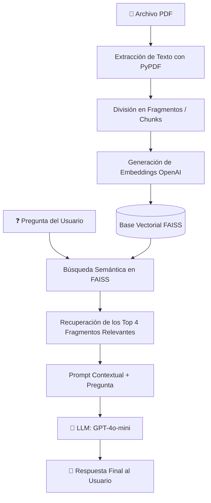

# 💬 Chat PDF - Asistente RAG para Análisis de Documentos

Aplicación interactiva basada en **Generación Aumentada por Recuperación (RAG - *Retrieval-Augmented Generation*)** desarrollada con **Streamlit**, **LangChain**, **FAISS** y los modelos de lenguaje de **OpenAI**. Permite a los usuarios cargar archivos PDF y realizar consultas en lenguaje natural, obteniendo respuestas precisas basadas estrictamente en el contenido del documento.

---

<p align="center">
  
</p>

---

## 🚀 Características Principales

- **Carga de Archivos PDF**: Procesamiento dinámico de documentos directamente desde el navegador web.
- **Segmentación Inteligente (Chunking)**: División del texto en fragmentos optimizados (`chunk_size=500`, `chunk_overlap=50`) mediante `RecursiveCharacterTextSplitter`.
- **Embeddings de Alta Eficiencia**: Vectorización semántica con el modelo `text-embedding-3-small` de OpenAI.
- **Búsqueda Vectorial Rápida**: Almacenamiento e indexación en memoria con **FAISS** para una recuperación por similitud ultrarrápida.
- **Caché de Rendimiento**: Uso de `@st.cache_resource` de Streamlit para no recalcular ni re-facturar embeddings innecesariamente durante la sesión.
- **Respuestas Basadas en Evidencia**: Síntesis de respuestas utilizando el modelo **GPT-4o-mini** (`temperature=0`), restringido a responder únicamente a partir del contexto del documento para evitar alucinaciones.
- **Transparencia en las Fuentes**: Visualizador desplegable para inspeccionar los fragmentos exactos del PDF utilizados para generar la respuesta.

---

## 🧠 Arquitectura RAG

El flujo de procesamiento sigue la arquitectura estándar de Generación Aumentada por Recuperación:



---

## 📁 Estructura del Proyecto

```text
chat_pdf/
│
├── app.py              # Aplicación principal en Streamlit con la lógica RAG
├── requirements.txt    # Lista de dependencias del entorno Python
├── Chat_pdf.png        # Imagen / logotipo de la aplicación
├── example.pdf         # Documento PDF de prueba
├── .gitignore          # Exclusiones para control de versiones (ej. config.py)
└── README.md           # Documentación del proyecto
```

---

## 🛠️ Tecnologías y Librerías

| Tecnología | Propósito |
| :--- | :--- |
| **Python** | Lenguaje base del proyecto |
| **[Streamlit](https://streamlit.io/)** | Framework frontend para la interfaz interactiva de usuario |
| **[LangChain](https://www.langchain.com/)** | Orquestación de componentes RAG, división de texto y cadenas de LLM |
| **[OpenAI API](https://platform.openai.com/)** | Generación de texto (`gpt-4o-mini`) y embeddings (`text-embedding-3-small`) |
| **[FAISS (Facebook AI Similarity Search)](https://github.com/facebookresearch/faiss)** | Base de datos vectorial en memoria para indexación y búsqueda por similitud |
| **[PyPDF](https://pypdf.readthedocs.io/)** | Extracción de contenido de texto de archivos PDF |
| **[Pillow](https://python-pillow.org/)** | Carga y manipulación de imágenes para la interfaz gráfica |

---

## ⚙️ Instalación y Configuración

### 1. Prerrequisitos

- **Python 3.10** o superior instalado en el sistema.
- Una **clave de API de OpenAI** activa ([Consíguela aquí](https://platform.openai.com/api-keys)).

### 2. Clonar el Repositorio

```bash
git clone https://github.com/estefaniamunoz801-ai/chat_pdf.git
cd chat_pdf
```

### 3. Crear y Activar un Entorno Virtual

- **En Windows (PowerShell):**
  ```powershell
  python -m venv venv
  .\venv\Scripts\Activate.ps1
  ```

- **En macOS / Linux:**
  ```bash
  python3 -m venv venv
  source venv/bin/activate
  ```

### 4. Instalar Dependencias

```bash
pip install -r requirements.txt
```

---

## ▶️ Uso de la Aplicación

1. **Iniciar el servidor local de Streamlit:**
   ```bash
   streamlit run app.py
   ```

2. **Acceder a la aplicación:**
   Se abrirá automáticamente una pestaña en tu navegador web predeterminado en `http://localhost:8501`.

3. **Pasos para interactuar:**
   1. Ingresa tu **Clave de API de OpenAI** en el campo correspondiente.
   2. Carga un archivo `.pdf` (puedes utilizar `example.pdf` provisto en el proyecto para probar).
   3. Observa las métricas de extracción (caracteres extraídos y número de fragmentos generados).
   4. Escribe tu pregunta en el cuadro de texto.
   5. Obtén la respuesta generada y despliega la sección **"Ver fragmentos recuperados"** para auditar las fuentes.

---

## ⚠️ Notas y Consideraciones

- **PDFs escaneados o imágenes**: La extracción de texto se realiza mediante `pypdf`. Si el archivo PDF es una imagen escaneada sin capa de texto (OCR previo), la herramienta indicará que no se pudo extraer texto.
- **Privacidad y Seguridad**: Tu clave de API de OpenAI se ingresa únicamente en memoria durante la sesión activa en el navegador; no se guarda en el disco ni se comparte en el repositorio.

---

